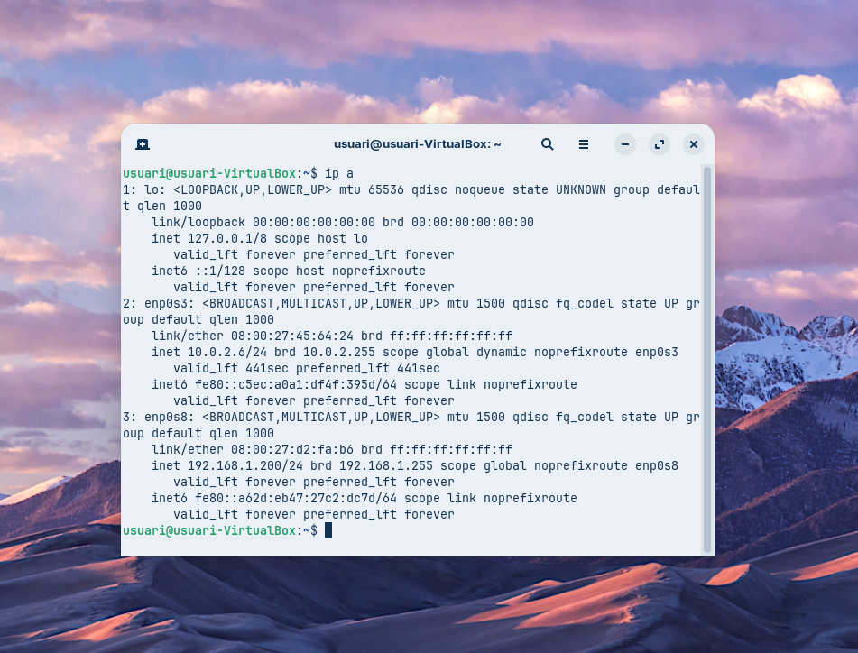
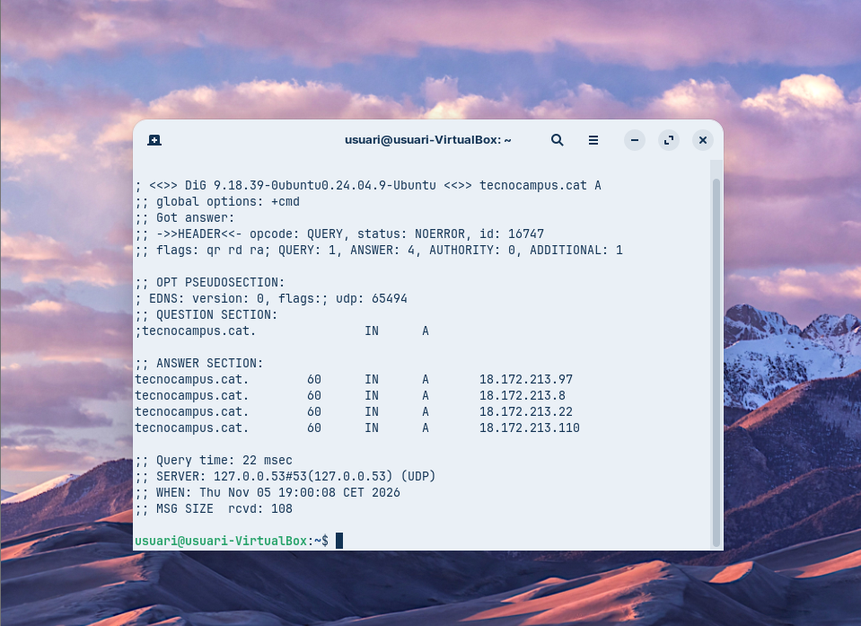
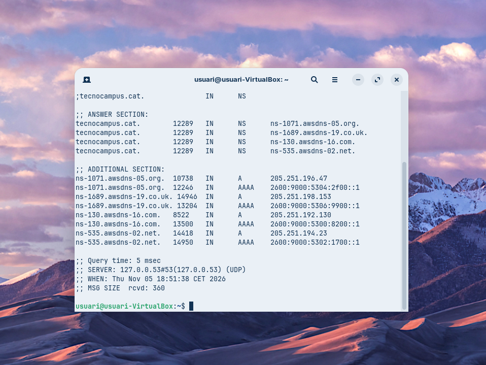
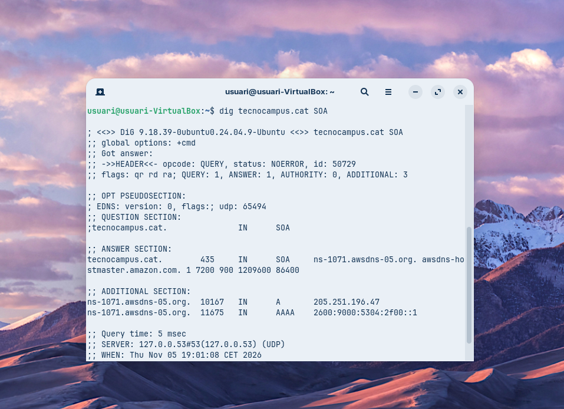
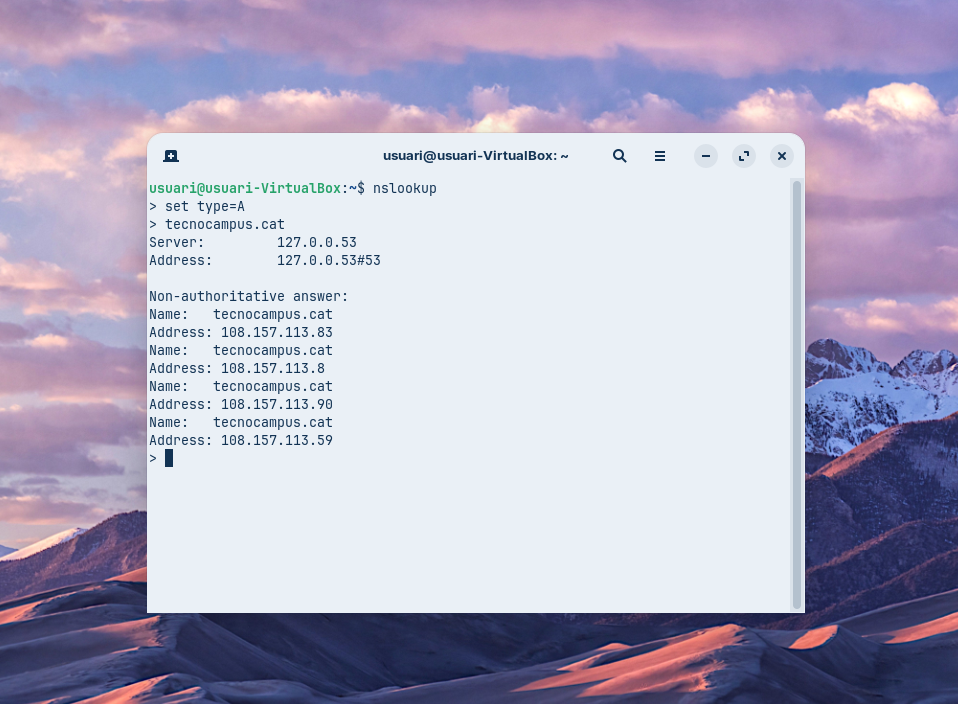
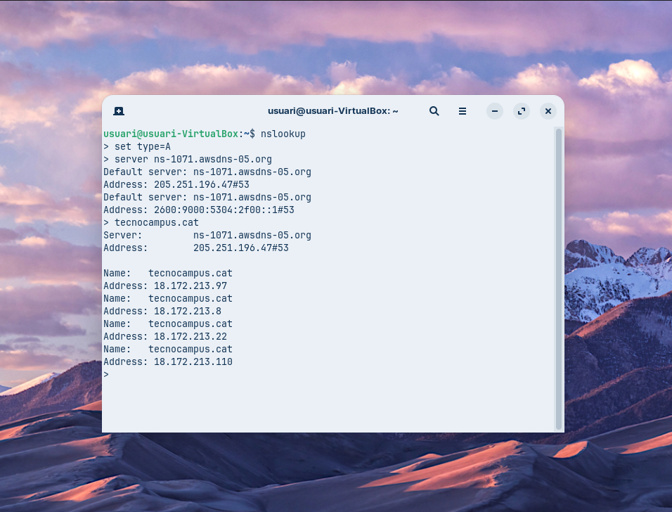
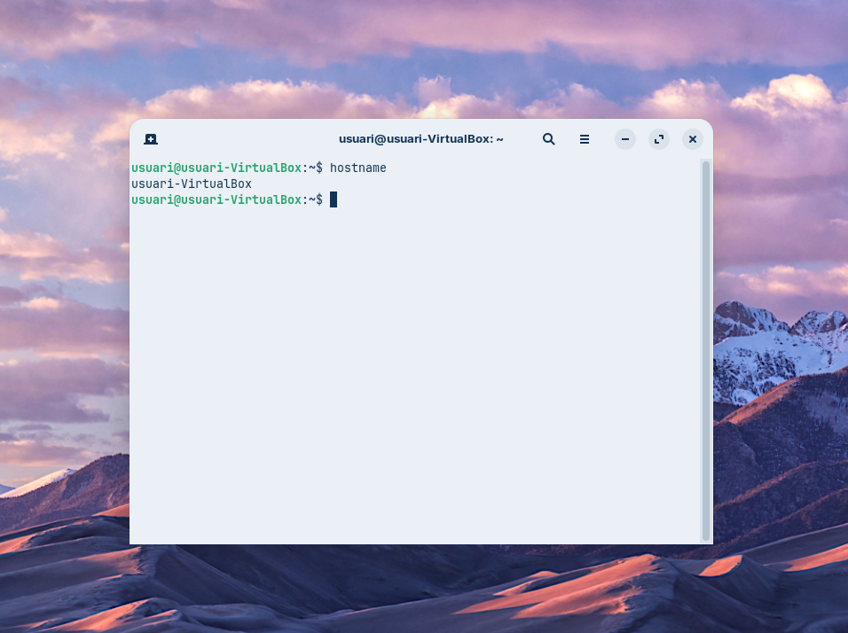
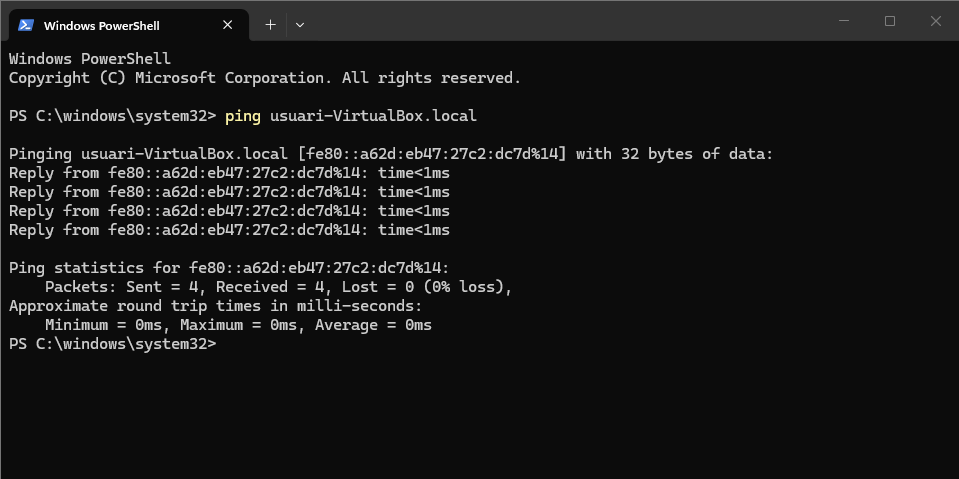

# Projecte de Consultoria DNS – TechCloud Solutions

**Client:** Innovació Tecnològica del Maresme S.L.
**Tècnic:** Jordi Evstegneev
**Mòdul:** 0227 Serveis de xarxa – CFGM SMX
**Data:** 05/11/2026

---

## 1. Vídeo explicatiu del DNS

- **Enllaç al vídeo:** [ENGANXA AQUÍ L'ENLLAÇ DE YOUTUBE]
- **Durada:** 6:09

---

## 2. Entorn de treball i configuració de xarxa

**Sistema operatiu:** Zorin OS (basat en Ubuntu 24.04) a VirtualBox
**Nom de la màquina:** `usuari-VirtualBox`

Comanda utilitzada: `ip a`



| Interfície | Mode VirtualBox | IP | MAC | Funció |
|---|---|---|---|---|
| lo | – | 127.0.0.1/8 | – | Loopback (el propi equip) |
| enp0s3 | NAT | 10.0.2.6/24 | 08:00:27:45:64:24 | Sortida a Internet a través de l'amfitrió |
| enp0s8 | Adaptador pont (Bridged) | 192.168.1.200/24 (estàtica) | 08:00:27:d2:fa:b6 | Connexió directa a la xarxa local |

Paràmetres estàtics de `enp0s8`: IP 192.168.1.200 · màscara 255.255.255.0 · porta d'enllaç 192.168.1.1 · DNS 8.8.8.8

**Comentari:**
- `enp0s3` està en mode **NAT** i rep la IP per DHCP de VirtualBox (per això apareix `dynamic`). És la que dona accés a Internet per fer les consultes DNS.
- `enp0s8` està en mode **adaptador pont** amb **IP estàtica**: ja no apareix la paraula `dynamic` i el temps de vida és `forever`. Aquesta interfície connecta la màquina directament a la xarxa local, com si fos un equip més, i això permet que altres equips la trobin (prova de mDNS).
- Les dues interfícies estan en estat `UP`.

---

## 3. Part A – Diagnosi amb `dig`

### Comanda 1 – Registre A

```bash
dig tecnocampus.cat A
```



**Anàlisi:**

- **Estat:** `NOERROR` → la consulta s'ha resolt correctament.
- **IPs de resposta (ANSWER SECTION):** el domini té 4 registres A:
  - 18.172.213.97
  - 18.172.213.8
  - 18.172.213.22
  - 18.172.213.110

  Tenir diverses IPs serveix per repartir la càrrega i tenir redundància (el web està allotjat a Amazon CloudFront).
- **TTL:** **60 segons**. És el temps que la resposta es pot guardar a la cache abans de tornar a preguntar. És un TTL molt baix, típic de serveis al núvol que poden canviar d'IP sovint.
- **Servidor DNS que ha respost:** `127.0.0.53#53` (port 53, UDP). És el resolver local de Linux (*systemd-resolved*), que reenvia la consulta al DNS de la xarxa i guarda les respostes a la cache.
- **Flags:** `qr rd ra` → és una resposta (`qr`), s'ha demanat recursivitat (`rd`) i el servidor la permet (`ra`). **No apareix `aa`**, per tant la resposta **no és autoritativa**.
- **Query time:** 22 ms.

### Comanda 2 – Servidors de noms (NS)

```bash
dig tecnocampus.cat NS
```



**Anàlisi:**

- **Estat:** `NOERROR` → consulta resolta correctament.
- **Servidors de noms (ANSWER SECTION):** el domini té 4 servidors NS, tots d'**Amazon Route 53**:
  - ns-1071.awsdns-05.org
  - ns-1689.awsdns-19.co.uk
  - ns-130.awsdns-16.com
  - ns-535.awsdns-02.net

  Estan repartits en 4 dominis de primer nivell diferents (.org, .co.uk, .com, .net). Així, si un TLD té problemes, el domini continua resolent-se (redundància).
- **TTL:** 12289 segons (unes 3,4 hores). Els NS canvien poc, per això el TTL és molt més alt que el del registre A.
- **ADDITIONAL SECTION:** el servidor afegeix les adreces IPv4 (A) i IPv6 (AAAA) de cada servidor NS. Per exemple, `ns-1071.awsdns-05.org` → 205.251.196.47 i 2600:9000:5304:2f00::1. Així el client no ha de fer una consulta nova per trobar-los.
- **Servidor que respon:** `127.0.0.53#53` (UDP) · **Query time:** 5 ms (més ràpid que abans perquè part de la informació ja era a la cache).

### Comanda 3 – Registre SOA

```bash
dig tecnocampus.cat SOA
```



**Anàlisi:**

- **Estat:** `NOERROR` · **Flags:** `qr rd ra` (sense `aa`, resposta no autoritativa).
- **Registre SOA:** `ns-1071.awsdns-05.org. awsdns-hostmaster.amazon.com. 1 7200 900 1209600 86400`

| Camp | Valor | Significat |
|---|---|---|
| Servidor primari (MNAME) | ns-1071.awsdns-05.org | Servidor DNS principal de la zona |
| Responsable (RNAME) | awsdns-hostmaster.amazon.com | Correu de l'administrador (`awsdns-hostmaster@amazon.com`) |
| Serial | 1 | Versió de la zona (Route 53 no l'incrementa) |
| Refresh | 7200 s (2 h) | Cada quant els secundaris comproven si hi ha canvis |
| Retry | 900 s (15 min) | Temps d'espera per tornar-ho a provar si el refresh falla |
| Expire | 1209600 s (14 dies) | Temps sense contacte amb el primari després del qual el secundari deixa de respondre |
| Minimum (TTL negatiu) | 86400 s (1 dia) | Temps que es guarda a la cache una resposta negativa (NXDOMAIN) |

- **TTL del registre:** 435 segons.
- **Servidor que respon:** `127.0.0.53#53` (UDP) · **Query time:** 5 ms.

### Comanda 4 – Resolució inversa (PTR)

```bash
dig -x 18.172.213.97
```


**Anàlisi:**

- `dig -x` fa una **consulta inversa**: a partir d'una IP busca el nom. Internament gira la IP i hi afegeix `.in-addr.arpa` → `97.213.172.18.in-addr.arpa`, tipus **PTR**.
- **Estat:** `NOERROR`.
- **Resposta:** `server-18-172-213-97.bcn50.r.cloudfront.net`
  - Confirma que la IP pertany a **Amazon CloudFront** (la CDN d'Amazon).
  - `bcn50` indica que el node que ens serveix és a **Barcelona**, el més proper a nosaltres.
- **TTL:** 82726 segons (gairebé 23 hores).
- **Query time:** 75 ms (més lent perquè no era a la cache i s'ha hagut de preguntar fins als servidors d'Amazon).

---

## 4. Part B – Diagnosi amb `nslookup`

### Comanda 5 – Consulta no autoritativa

```bash
nslookup
> set type=A
> tecnocampus.cat
```



**Anàlisi:**

- **Servidor:** `127.0.0.53` (port 53), el resolver local del sistema.
- Apareix el missatge **`Non-authoritative answer`**: la resposta ve d'un servidor que **no és el propietari de la zona**. La resposta és correcta, però l'ha obtingut d'un altre servidor o de la cache.
- **IPs obtingudes:** 108.157.113.83 · 108.157.113.8 · 108.157.113.90 · 108.157.113.59
- **Observació:** aquestes IPs són **diferents** de les de la Comanda 1 (18.172.213.x). És normal: CloudFront canvia les IPs sovint (TTL de 60 s) i en dona de diferents segons el moment i el node. Això demostra per què el TTL és tan baix.

### Comanda 6 – Consulta autoritativa

```bash
nslookup
> set type=A
> server ns-1071.awsdns-05.org
> tecnocampus.cat
```



**Anàlisi:**

- Amb `server` canviem el servidor DNS i preguntem directament a **`ns-1071.awsdns-05.org`**, un dels NS oficials del domini (Comanda 2).
  - Adreça IPv4: 205.251.196.47#53 · IPv6: 2600:9000:5304:2f00::1#53
- **Ja no surt `Non-authoritative answer`** → la resposta és **autoritativa**, perquè ve del servidor que gestiona la zona.
- **IPs obtingudes:** 18.172.213.97 · 18.172.213.8 · 18.172.213.22 · 18.172.213.110 (les mateixes que la Comanda 1).

**Comparació:**

| | Comanda 5 | Comanda 6 |
|---|---|---|
| Servidor consultat | 127.0.0.53 (resolver local) | ns-1071.awsdns-05.org (205.251.196.47) |
| Tipus de resposta | No autoritativa | Autoritativa |
| Origen de les dades | Cache / altres servidors | Servidor propietari de la zona |
| IPs | 108.157.113.x | 18.172.213.x |

---

## 5. Part C – Resolució local amb mDNS

### Nom de la màquina

```bash
hostname
```



El nom de la màquina virtual és **`usuari-VirtualBox`**. Amb mDNS, s'hi pot accedir des de la xarxa local com a **`usuari-VirtualBox.local`**.

### Prova des d'un altre equip (Windows)

```powershell
ping usuari-VirtualBox.local
```



**Anàlisi:**

- L'equip Windows ha resolt `usuari-VirtualBox.local` **sense cap servidor DNS**: ho ha fet amb **mDNS** (multicast DNS, port UDP 5353). Pregunta a tota la xarxa local "qui és usuari-VirtualBox?" i la màquina Linux (servei *Avahi*) respon amb la seva adreça.
- Ha resolt l'adreça IPv6 local d'enllaç **`fe80::a62d:eb47:27c2:dc7d%14`** (`%14` és l'índex de la interfície de Windows).
- **Resultat:** 4 paquets enviats, 4 rebuts, **0 % de pèrdua**, temps < 1 ms → els dos equips són a la mateixa xarxa local.
- Ha funcionat perquè `enp0s8` està en **mode pont**: la VM és un equip més de la LAN. Amb només NAT, el multicast no arribaria a l'amfitrió.

---

## 6. Conclusions

- `tecnocampus.cat` està allotjat a **Amazon Web Services**: el DNS el gestiona **Route 53** (4 servidors NS en TLDs diferents) i el web se serveix des de **CloudFront**, amb un node a Barcelona.
- El **TTL baix (60 s)** del registre A permet canviar les IPs ràpidament. Ho hem vist: les comandes 1 i 5 han donat IPs diferents.
- Hi ha diferència entre una resposta **no autoritativa** (del resolver local o la cache) i una **autoritativa** (directament del servidor NS de la zona). Per diagnosticar problemes és millor preguntar al servidor autoritatiu.
- `dig` dona molta més informació (flags, TTL, seccions, temps) i és millor per diagnosticar. `nslookup` és més simple i permet canviar de servidor de forma interactiva.
- A la xarxa local no cal un servidor DNS: **mDNS** permet trobar els equips pel nom `.local`, sempre que estiguin a la mateixa xarxa (mode pont).

---

## 7. Fonts i eines consultades

- Pàgines de manual: `man dig`, `man nslookup`, `man avahi-daemon`
- RFC 1034 i RFC 1035 – Domain Names (concepts / implementation)
- RFC 6762 – Multicast DNS
- Documentació d'Amazon Route 53 i Amazon CloudFront (docs.aws.amazon.com)
- Apunts del mòdul 0227 Serveis de xarxa
- Eines: `ip`, `dig` (BIND 9.18.39), `nslookup`, `hostname` a Zorin OS; `ping` a Windows PowerShell
