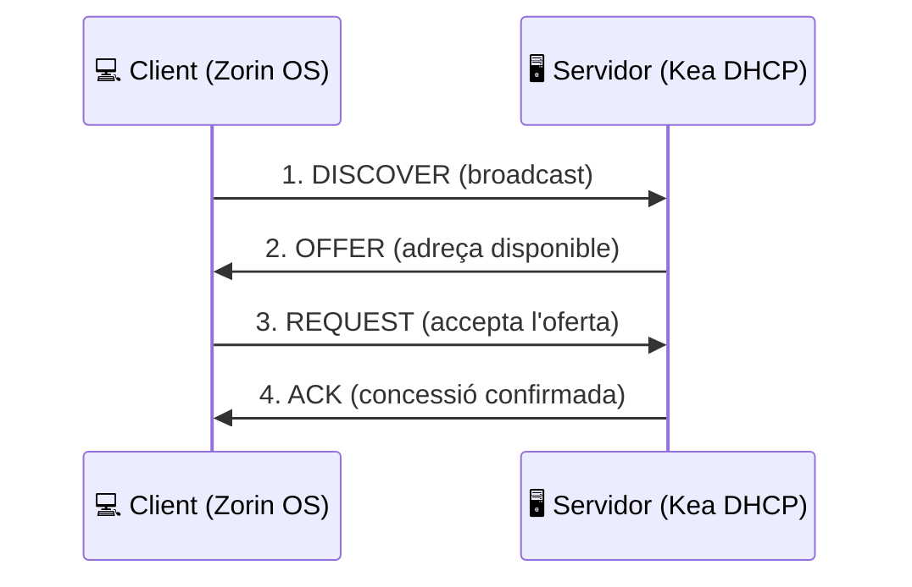

  

  

  
  
  
  
  

  
  
  

## 📂 Contingut

| | Activitat | Descripció | Estat |
| :--: | --- | --- | :--: |
| 🖧 | [**AA2 · Avaluació Server DHCP**](./AA2-Avaluaci-Server-DHCP.d.d.d.d) | Desplegament i configuració d'un servidor DHCP amb Kea, comprovació des del client i anàlisi del procés DORA. | ✅ |
| 🔜 | *Properes activitats* | El repositori s'anirà ampliant durant el curs. | ⏳ |

## 🔄 El procés DORA

🛠️ <b>Entorn de treball</b> (clica per desplegar)

 

| Component | Eina |
| --- | --- |
| 🖥️ Servidor | Ubuntu Server 24.04 LTS |
| 💻 Client | Zorin OS Core |
| 📦 Virtualització | VirtualBox |
| 🌍 Serveis | Kea DHCP · Netplan · SSH |
| 🔍 Anàlisi | Wireshark |

📋 <b>Com està organitzat</b>

 

Cada activitat té la seva carpeta amb el document de lliurament i les captures
que serveixen d'evidència. En les pràctiques es documenta el **valor esperat**,
el **valor observat** i la **conclusió** de cada comprovació.

> [!NOTE]
> Repositori acadèmic del cicle de Sistemes Microinformàtics i Xarxes (SMX).

  👤 <b>Jordi Evstegneev</b> · 2n SMX · Curs 2025–2026

